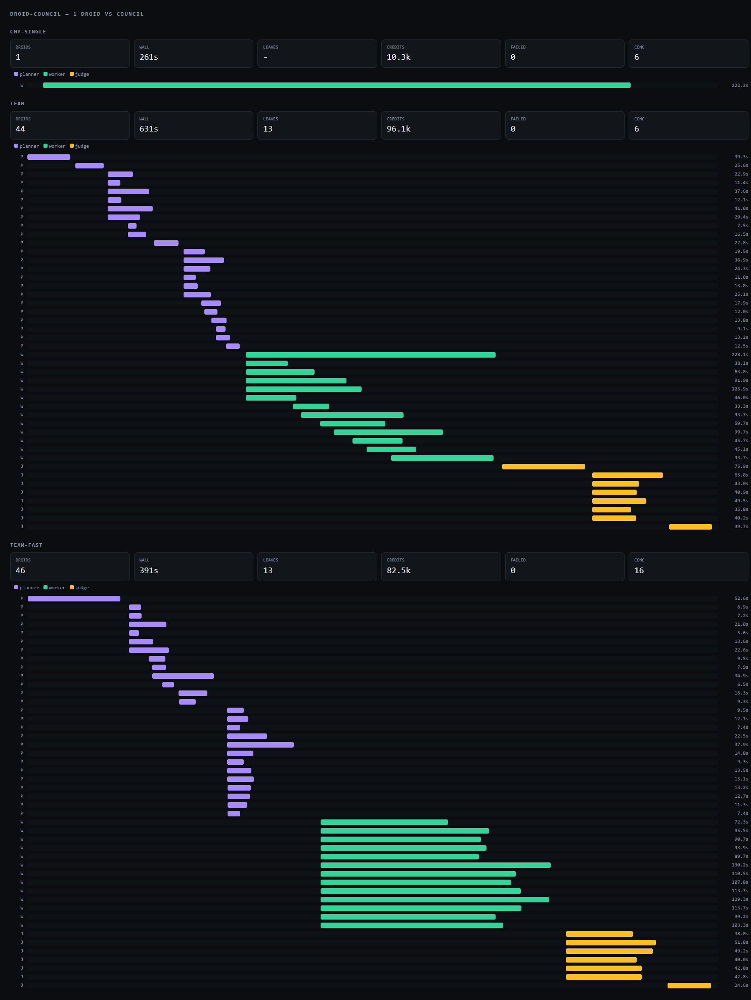

# droid-council

A council of droids that decompose a task, work in parallel, and merge their findings into one result. Built on the [Droid TypeScript SDK](https://docs.factory.com/sdk/typescript).

```bash
npm install
echo "FACTORY_API_KEY=fk-..." > .env     # https://app.factory.ai/settings/api-keys
npm run council -- "Build a REST API for a todo app, with tests"
```

The npm scripts load `.env` with `--env-file-if-exists`, so the key only has to exist
there. To run the engine directly, `npx tsx --env-file-if-exists=.env council.ts "<task>"`.

One TypeScript process owns the whole council. Every droid is a single SDK `run()` call.

```
  EXPAND          EXECUTE              REDUCE
  breadth-first   fixed worker pool    bottom-up, level by level

      root                                merge
     /  |  \                              /  |  \
   leaf leaf leaf   ← run in parallel →  r1  r2  r3
    |    |    |                            \  |  /
   leaf leaf leaf   ← run in parallel →      root
```

## Two films

Both are in this repo, both are rendered from HTML with [HyperFrames](https://hyperframes.heygen.com), and both are built from the real event logs in `runs/` rather than from illustrations.

| Cut | What it is |
|---|---|
| [`loom/renders/droid-council-loom.mp4`](loom/renders/droid-council-loom.mp4) | **60 s.** A Loom-style screen recording of the run. Clippy presents — a wire paperclip, not a webcam — with a speech card that changes fourteen times, a `REC` pill and a running clock. The 1997 desktop is the conceit: a terminal recording of a terminal job. |
| [`video/renders/droid-council-sheet.mp4`](video/renders/droid-council-sheet.mp4) | **48.6 s.** The drafting-sheet cut. No mascot, no jokes: the three runs drawn as measured tracks on one axis, then the same thirteen tasks compared as work done rather than wall clock. |

The thirteen worker bars in the Loom cut are the thirteen real per-worker durations read out of `runs/team-fast/events.jsonl`, and their one-frame stagger is the real spread — all thirteen workers started within about 30 ms of each other.

To rebuild either from source:

```bash
cd loom        # or cd video
npm install
npm run render
```

Narration is Sarvam `bulbul:v4-flash` — fourteen lines, 55.8 s of speech, written by `video/voice.py`. The music is hand-composed in numpy: a chiptune for the desktop cut (`video/mkbgm.py`) and a slow pad bed for the sheet cut (`video/mkbgm2.py`). No model, no account, deterministic.

## Measured results

Six-module Python package with a pytest suite per module, same task, same model (`glm-5.3-flash`, high reasoning). Test counts independently re-verified by running `pytest` myself afterwards.



| | Single droid | Council, concurrency 6 | Council, concurrency 16 |
|---|---|---|---|
| Wall clock | **261s** | 631s | 391s |
| Droids | 1 | 44 | 46 |
| Credits | **10,311** | 96,094 | 82,550 |
| Tests passing | 57 | 51 | **60** |

The run artifacts behind the table are in the repo: [`runs/cmp-single/report.json`](runs/cmp-single/report.json), [`runs/team/report.json`](runs/team/report.json) and [`runs/team-fast/report.json`](runs/team-fast/report.json) are the three runs, and [`runs/team-fast/events.jsonl`](runs/team-fast/events.jsonl) is the per-worker event log the films are rendered from. The rest of `runs/` is scratch space and stays out of git.

The chart is the whole story. Purple bars are planners, green are workers, amber are judges. At concurrency 6 the workers form a **staircase** — only 6 run at a time, so the pool is the bottleneck. At concurrency 16 all 13 workers start within 200ms of each other: a solid parallel block, and the wall clock drops 38% with no other change.

**Read this honestly: for a task this size, one droid wins.** The council produced slightly more tests at high concurrency, but it was slower and roughly 8x more expensive.

The reason is fixed per-droid cost. Every droid pays a session init (30-60s here) before doing any work, so:

```
wall clock  ≈  (droids / concurrency) × init  +  actual work
```

With 46 droids that startup term dominates completely. That is the real scaling law of this architecture, and it has two consequences:

- **Concurrency is the lever.** It is the first knob to turn, not the last.
- **A council pays off when work exceeds one context window** — many large independent workstreams, a repo-wide audit, 500 files to classify. Splitting a task one droid can already hold just adds startup cost.

`--plan-only` exists so you can see the shape and the cost before spending anything.

## Scaling to any size

The council size is set by three independent knobs, and nothing in the code assumes a particular number:

| Knob | Meaning |
|---|---|
| `--leaves N` | Max leaf tasks. The real size control. |
| `--concurrency N` | Droids running at once. Throughput. |
| `--agents N` | Hard ceiling on total droid runs. A budget, not a target. |
| `--depth N`, `--fanout N` | How eagerly the tree splits. |

Because droids never spawn droids — this process owns every node — one counter bounds the entire council at any size. The same code path runs 2 droids or 100,000; only the numbers change.

Practical ceilings are your API rate limit and your wallet, not the architecture. At `--concurrency 16` a 1,000-leaf council is ~60 waves; at `--concurrency 128` it is ~8. Cost is `droids × per-droid cost`, which is why `--agents` is enforced as a hard stop rather than a suggestion.

## The three invariants

Everything else is detail. These are what make it safe to scale.

**1. Droids never spawn droids.** The orchestrator spawns. If droids could spawn droids, nothing would bound the tree and you would get a fork bomb with a bill. One process owning every node is what makes a single global counter sufficient.

**2. The semaphore wraps the SDK call, never the recursion.** A parent that held a concurrency slot while awaiting its children would deadlock at depth ≥ 2: every slot held by a waiting parent, none left for the child it waits on. `slot()` wraps only `run()`.

**3. Decomposition is separated from execution.** Recursive spawning holds a live parent process per branch, which is what caps that design at shallow depth. Here, expand writes a plan, execute drains a flat leaf queue with a fixed pool, and reduce walks back up. No parent blocks a child.

## How the droids communicate

Two directions, deliberately asymmetric:

- **Up:** every node returns a report to its parent, which merges. Judges are told to reconcile contradictions by naming a winner, never by averaging.
- **Sideways:** siblings share `board.md` — append-only, read-before-write. This is how droids working on different files still benefit from each other's discoveries.

In the run above this worked for real: one droid hit an `UnboundLocalError` in `strip_html.py`, recorded it on the board, another droid fixed it, and the judge's final report named that fix explicitly.

No message bus, no vector store, no shared memory service. A file and a return value cover what actually needs to move.

## A third channel, through the hardware

Both channels above move information *through the operating system*: a return value, a file. There is a third one that does not.

`channel/` is a working covert channel between two isolated processes on one host. The receiver reads no file the sender wrote and opens no socket. What the two processes share is the silicon underneath them.

```
   sender                            receiver
   8 processes stream    ──►         times a dependent-load walk
   a 64 MB buffer                    over a 4 MB buffer
   → evicts L3                       → 1 if the walk is slow, 0 if it is fast
```

**The physical layer.** The sender streams a buffer far larger than the 25.6 MB L3 from eight processes at once; the receiver times a walk over a 4 MB buffer that would normally live in L3. While the hammers run, that buffer is not there any more and the walk slows down. One slot becomes one bit.

Four candidates were measured before this one held up:

| Candidate | Result |
|---|---|
| Raw DRAM throughput contention | **1.02x** — no signal at all |
| Per-slot *minimum* walk latency | **BER 0.50** — the receiver's own walking re-warms L3 faster than a 50 ms burst can evict it, and the minimum picks out the lucky samples |
| A single hammer process | unreliable — BER 0.09 on one run, 0.38 on an identical later run |
| **Streaming hammers + lower-half-mean** | **~1.45x separation** — the one that works |

**The coding layer, because the baseline drifts.** Over a 28 s frame the receiver's own walk time climbs as the hammers heat the machine, so a single preamble at the front calibrates the first second and nothing after it. Each block instead carries its own pilots, and the receiver thresholds every block against its own two levels. The pilots alternate `1,0,1,0` rather than `1,1,0,0`, because the receiver's cache stays warm for a moment after the hammers stop and a run of 0s straight after a run of 1s reads high.

**Measured.** 8 hammers, 100 ms slots, 5 slots per bit, 4 data bits per pilot block, i7-12700K:

| | |
|---|---|
| Per-block level separation | **1.45x** mean, 1.15x worst |
| Single frame of 4 bytes | **6 of 8 decoded clean** |
| Payload rate, one copy | **1.11 bit/s** — 32 payload bits inside 28.8 s |
| Payload rate, two copies | 0.56 bit/s, and the CRC picks whichever copy survived |

A frame is `8 length bits + payload + 8 CRC bits`. One bad block costs the whole frame, so the frame can be sent as K independent copies and the CRC decides which to trust. Payloads are compared as hex, not as text, so the channel does not assume the bytes are valid UTF-8.

```bash
npx tsx channel/channel.ts bench --trials 8              # end-to-end frame rate on your machine
npx tsx channel/channel.ts send --msg "A7F3" --repeat 2  # transmit; spawns its own receiver
```

And through the council:

```bash
npx tsx council.ts --covert-only
#   0s  covert | two isolated processes, 4 B, no shared file, no socket
# 132s  covert | receiver recovered ed799651 over the timing channel — 2 attempt(s), 132s
```

`--covert` runs the same relay as a phase before the council starts. The result lands in `events.jsonl` as a `kind: "covert"` event carrying the bytes sent and the bytes received, so the claim is checkable after the fact rather than taken on faith.

**The honest caveats.** It is about 1 bit/s, so it moves a token, a digest or a handshake — not a conversation. And the two sides must already agree on a wall-clock start time out of band; that agreement is the one thing the channel itself cannot carry. The probes that rejected the other three candidates are kept in `channel/probe.mjs` and `channel/probe2.mjs`, so the negative results are reproducible rather than merely asserted.

**It also crosses a VM boundary.** The attacks this is modelled on used two VMs on one host rather than two processes, which is the stronger claim — a process boundary still shares a kernel, a page cache and a clock. `channel/vmtest.mjs` closes that gap: the sender runs on the Windows host, the receiver inside a Linux container started with `--network none`, so there is no file, no socket and no kernel in common. Only L3, plus a start time agreed beforehand.

The two clocks do not agree, and 100 ms slots do not forgive a large offset, so the harness measures the skew first by ping-ponging a live container over stdin. The round trip brackets the error; the tightest of fourteen pings came back at 1 ms, putting the offset at **0.5 ms**.

```
$ node channel/vmtest.mjs 4 2
offset   host − container = 0.5 ms  (±0.5 ms from the tightest of 14 pings, best round trip 1 ms)
sender   this Windows host, 8 hammer processes
receiver linux container, --network none, read-only bind mount, node:22-alpine
sent     0b30557a
received 0b30557a   CRC ok on copy 2/2
separation 2.35x mean
CROSSED: a Linux container recovered 4 bytes from a Windows process through cache timing alone.
```

**The boundary is free; the machine is not.** That run separated at 2.35x — better than the 1.45x the same code managed process-to-process earlier the same day, so the container costs essentially nothing. What moves the number is background load. With four unrelated containers running on the host, the same test collapsed to 1.15x and failed, and a process-to-process control **failed at exactly the same 1.15x**. Same code, same machine, lower noise floor.

So read the reliability numbers as a property of how busy the box is, not of how well isolated the two sides are. A quiet machine decodes; a busy one does not, and no amount of frame repetition recovers a signal that has stopped separating.

## Roles

| Role | Job |
|---|---|
| `planner` | Splits one task into independent subtasks. Read-only — planners cannot touch files. |
| `worker` | Does one leaf task. Writes real artifacts. Owns only its own files. |
| `judge` | Merges reports into one authoritative result. |

## Artifacts

Every run writes to `--cwd` (`runs/<timestamp>/` by default):

| File | Contents |
|---|---|
| `plan.json` | The full node tree: parents, children, depths, tasks |
| `events.jsonl` | One JSON line per lifecycle event, for the UI |
| `board.md` | The shared blackboard |
| `answer.md` | The final merged result |
| `report.json` | Droids used, tokens, credits, duration, failures |

## Options

```
--mode MODE      single (1 droid baseline) | team   (team)
--leaves N       max leaf tasks to execute          (48)
--depth N        max planning depth                 (3)
--fanout N       max subtasks per split             (6)
--concurrency N  droids running at once             (8)
--agents N       total droid budget, hard stop      (200)
--panel N        attempts per leaf, judged          (1)
--models a,b,c   model per spawn, round-robin       (auto)
--cwd PATH       working dir + artifact dir         (runs/<timestamp>)
--label NAME     name this run for the UI           (run)
--auto LEVEL     off|low|medium|high                (medium)
--reason LEVEL   off|low|medium|high|xhigh|max      (high)
--covert         run the timing side-channel relay before the council
--covert-only    run just the relay and exit, no droids
--plan-only      expand and print the plan, spawn no workers
```

**`--covert-only`** is the fastest way to see the side channel work end to end. It spawns two isolated processes, hands one a 4-byte secret, and reports what the other one recovered.

**`--plan-only`** is the cheap way to size a task. It runs only the planners and tells you the node count, leaf count, and estimated droid spend before you commit.

**`--panel N`** runs N *different* models on the same leaf and judges their outputs. Independent attempts that agree are worth more than one attempt at higher reasoning effort. Use it where being wrong is expensive; leave it at 1 for mechanical work.

**`--mode single`** is the honest baseline. Always worth running for a new task shape.

## UI

```bash
npm run ui        # http://localhost:8787
```

Replays any run from its `events.jsonl`: the tree as it expands, droids starting and finishing, the blackboard filling up, and the comparison between runs.

To share a run without a server, export a single self-contained file:

```bash
npx tsx export.ts                 # every run under runs/ → council-report.html
npx tsx export.ts team team-fast  # only these runs
```

`council-report.html` embeds the events, blackboards, and answers, so it opens from disk, over email, or on a static host with no server and no network. Screen-record that page for a demo video of the council working.

## Requirements

Node 18+, and a **`FACTORY_API_KEY`**. The SDK requires the key explicitly; it does *not* reuse the droid CLI's stored login, so a working `droid exec` alone is not enough.

Every command here is written as `npx tsx <file>`. If your npm install does not put `node_modules/.bin` on PATH, the same thing without the shim is `node node_modules/tsx/dist/cli.mjs <file>`.

A matching `@factory/cli` is installed as a dev dependency and used automatically, because the SDK and CLI must agree on a JSON-RPC protocol version. A stale CLI rejects session init with `-32600`, and the only symptom is a 60s timeout on *every* droid — indistinguishable from slow work. `council.ts` checks the version at startup and refuses to run rather than burn an hour pretending to be busy.

## Design notes

**Atomicity is decided by code, not the model.** The planner returns a list of subtasks and nothing else; fewer than two usable subtasks means a leaf. An earlier version asked the model for an `atomic` boolean and it would occasionally answer `atomic: true` while listing six deliverables, silently collapsing the whole council to a single droid. Removing that field from the model's control removed the failure mode.

**Planning failure degrades, never aborts.** A planner that fails, times out, or returns nothing schema-conforming becomes a leaf and executes directly. With thousands of nodes, partial results are the normal case.

**Root-level retry.** If the root planner declines to split, it gets one retry with an explicit nudge — a wrong decision there collapses the entire council. Deeper down, "this is one file" is usually correct, so no retry is spent.

**What is not here.** No checkpoint/resume of a half-finished council, no retry-with-backoff on rate limits, no cross-machine distribution. Those are the right next additions at real scale, and none of them change the three invariants.

## License

MIT
